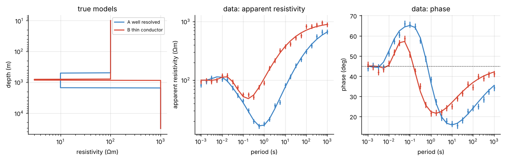
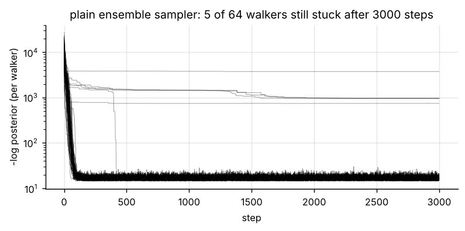
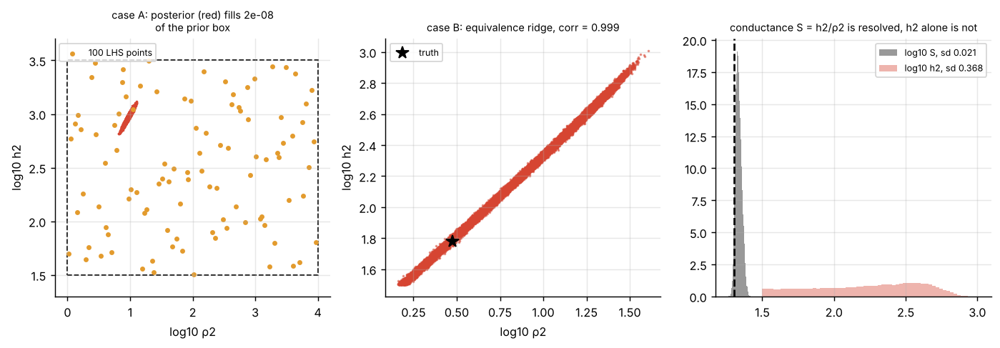
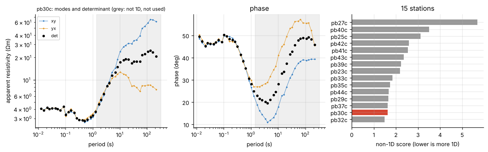
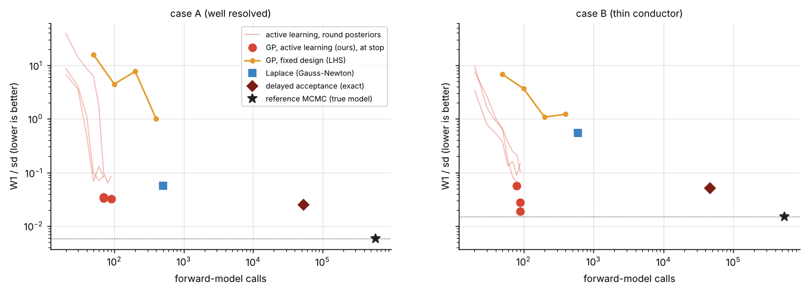
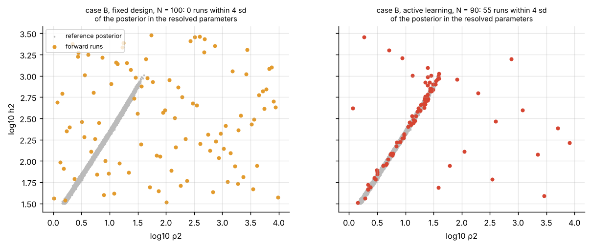
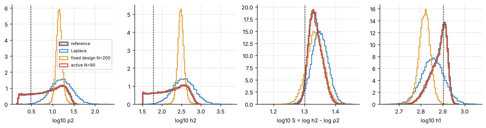
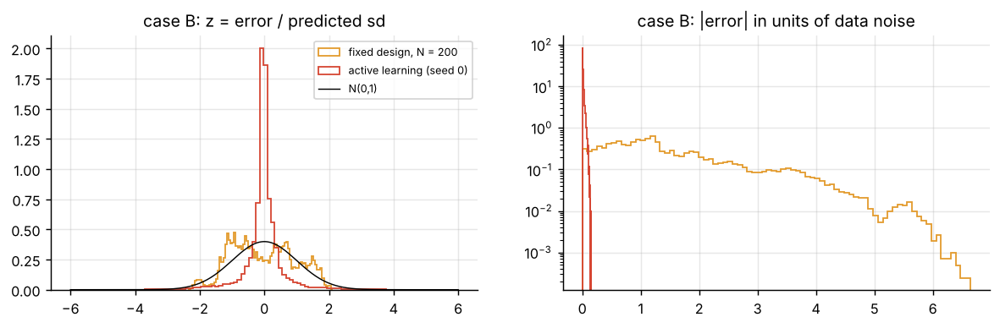
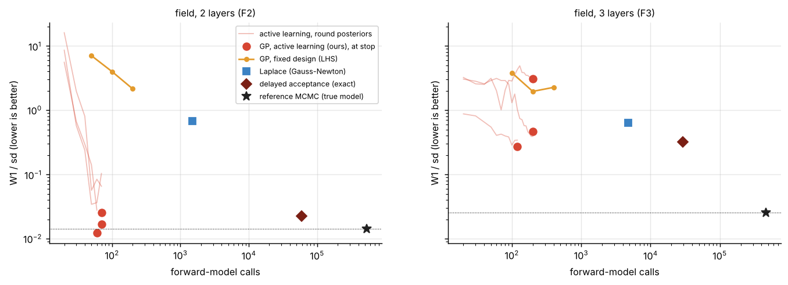
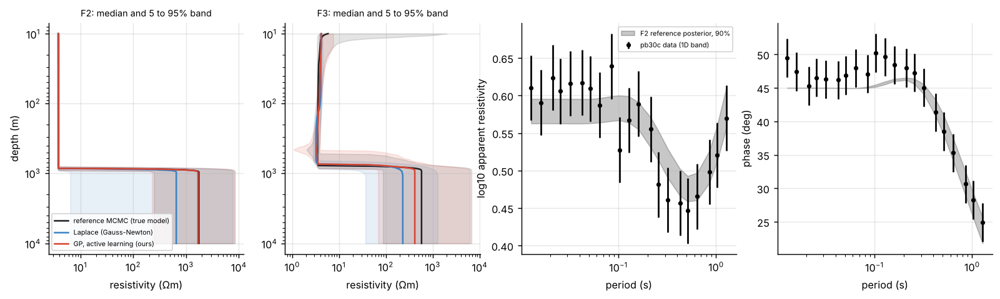

# Gaussian process surrogates for Bayesian magnetotelluric inversion

How many forward-model runs does a Bayesian inversion really need? This project measures it on a problem where the exact answer can still be computed: 1D magnetotelluric (MT) inversion, with two synthetic cases and a real broadband station.

Everything is in one notebook, [`gp_surrogate_mt.ipynb`](gp_surrogate_mt.ipynb), with all outputs saved. A plain-Python copy, [`gp_surrogate_mt.py`](gp_surrogate_mt.py) (Jupytext percent format), is kept for clean diffs.

**Main result:** a Gaussian process emulator, trained with active learning and a stopping rule, reproduces the full posterior with **60 to 90 forward calls** in every well-posed case and for every random seed. The reference MCMC uses about 550,000 calls. A space-filling design and a Laplace approximation both fall short. For an over-parameterised model, no method succeeds within 200 runs, and the stopping rule correctly refuses to stop.

---

## 1. The problem

**Forward model.** For flat layers with resistivities $\rho_j$ and thicknesses $h_j$, the surface impedance follows Wait's recursion from the bottom up:

$$
k_j = \sqrt{i\omega\mu_0/\rho_j}, \qquad Z^{(0)}_j = i\omega\mu_0/k_j, \qquad
Z_j = Z^{(0)}_j \frac{Z_{j+1} + Z^{(0)}_j \tanh(k_j h_j)}{Z^{(0)}_j + Z_{j+1} \tanh(k_j h_j)}
$$

The data are apparent resistivity $\rho_a = |Z_1|^2/(\omega\mu_0)$ and phase $\varphi = \arg Z_1$ across frequency.

**Inversion.** Uniform prior on a box in $\theta = (\log_{10}\rho_j, \log_{10}h_j)$ and Gaussian errors:

$$
\log p(\theta \mid d) = -\frac{1}{2}\sum_i \left(\frac{g_i(\theta) - d_i}{\sigma_i}\right)^2 + \text{const}
$$

**Cost.** A 1D model runs in microseconds, but a 3D MT solve takes minutes to hours. So cost is counted in **forward-model calls**, and the 1D case lets every surrogate be scored against an exact reference.

| Case | Model | What it tests |
|---|---|---|
| **A** | 3 layers: 100 Ωm / 500 m, 10 Ωm / 1000 m, 1000 Ωm | the basic cost-accuracy trade-off |
| **B** | 3 layers with a thin conductor: 3 Ωm / 60 m | equivalence: only the conductance $h_2/\rho_2$ is resolved |
| **F2** | field station pb30c, 2 layers | real data; the model the data support |
| **F3** | field station pb30c, 3 layers | a deliberately over-parameterised model with a broad posterior |



## 2. Why it is hard

- **Cost:** the reference MCMC needs about half a million forward runs.
- **Local modes:** an ensemble sampler started at random leaves walkers stuck far from the posterior (5 of 64 here).
- **A tiny posterior:** in case A it fills about $10^{-8}$ of the prior box, so points spread over the box almost never land in it.
- **Equivalence:** in case B, $\log\rho_2$ and $\log h_2$ have correlation 0.999. The conductance is known to 0.02 decades, the thickness only to 0.37.





## 3. Data

Fifteen broadband MT stations (EDI files, 43 frequencies from 0.005 to 78 Hz) from a survey near Paralana, South Australia, acquired by the University of Adelaide in 2011 and distributed as example data with the open-source MTpy package. Files are pinned to one commit and checked by SHA-256; see the MTpy repository for terms of use.

**Choosing the 1D band.** Station pb30c is among the most 1D by median skew and mode split. However, its two modes separate beyond about 1 s (by 8 s the resistivities differ by a factor of 1.6 and the phases by 20°). Only the band from the shortest period up to the first period with a mode split above 0.1 decades or a phase difference above 5° is used: **periods up to 1.28 s, 21 frequencies**. The determinant impedance is inverted with a 5% error floor on $|Z|$.



## 4. Method

1. **Emulate the data, not the likelihood.** The output vector (log apparent resistivity and phase at every frequency) is standardised, compressed with PCA (up to 12 components), and each component gets a GP with a Matérn-5/2 kernel, one length scale per parameter, and a nugget.
2. **Surrogate likelihood with emulator error.** The GP variance $v_i(\theta)$ is added to the data variance:

$$
\log \tilde p(\theta \mid d) = -\frac{1}{2}\sum_i \left[\frac{(m_i(\theta) - d_i)^2}{\sigma_i^2 + v_i(\theta)} + \log\left(\sigma_i^2 + v_i(\theta)\right)\right]
$$

3. **Active learning.** Start from 20 Latin hypercube runs. Each round samples the surrogate posterior and adds 10 runs where the emulator is least sure in units of data noise, $\sum_i v_i/\sigma_i^2$, spread out by a soft repulsion.
4. **Stopping rule.** Stop when two successive rounds change the surrogate posterior by less than 0.25 (W1/sd, below) **and** the best run fits the data with $\chi^2/N \lt 2$, or at 200 runs. Both checks use only quantities already in hand, so the rule costs no forward calls.
5. **Sampler.** An affine-invariant ensemble sampler (stretch move, 64 walkers). It starts around the best mode from a global scan plus Nelder-Mead from the training runs with the best true misfit, and resets stuck walkers during burn-in only.
6. **Delayed acceptance (exact variant).** The surrogate screens each proposal, and the true model corrects only the proposals that pass.

**Baselines:** reference MCMC with the true model (two independent runs); Laplace (Gauss-Newton fit from 8 starts, Gaussian with covariance $(J^\top \Sigma^{-1} J)^{-1}$); GP on a fixed Latin hypercube design.

**Metric:** for each parameter, the Wasserstein-1 distance between the method's marginal and the reference marginal, divided by the reference standard deviation, averaged over parameters (0 is perfect). The two reference runs set the noise floor.

## 5. Results

### Synthetic cases



| Case | Method | Forward calls | W1/sd |
|---|---|---|---|
| A | **active GP, 3 seeds** | **70, 90, 70** | **0.034, 0.032, 0.033** |
| A | Laplace | 506 | 0.057 |
| A | fixed-design GP | 50 / 100 / 200 / 400 | 15.8 / 4.5 / 7.6 / 1.0 |
| A | delayed acceptance | 53,007 | 0.025 |
| A | reference | 581,693 | 0.006 (noise floor) |
| B | **active GP, 3 seeds** | **90, 80, 90** | **0.028, 0.057, 0.019** |
| B | Laplace | 597 | 0.55 |
| B | fixed-design GP | 50 / 100 / 200 / 400 | 6.8 / 3.7 / 1.1 / 1.2 |
| B | delayed acceptance | 46,375 | 0.051 |
| B | reference | 536,868 | 0.015 (noise floor) |

- Active learning reaches reference quality with **70 to 90 calls**, roughly 6,000 times fewer than the reference, and every seed stopped on its own.
- The fixed design fails even with 400 runs.
- Laplace works for the near-Gaussian case A and fails on the equivalence ridge of case B.
- Delayed acceptance is exact but needs about 50,000 calls. It buys a guarantee, not a large saving.





**Is the emulator's uncertainty honest?** At 1000 reference-posterior samples:

| Case | Emulator | 90% interval coverage | RMS error / data noise |
|---|---|---|---|
| A | fixed design, N = 200 | 0.85 | 2.35 |
| A | active learning | 1.00 | 0.014 |
| B | fixed design, N = 200 | 0.93 | 1.92 |
| B | active learning | 0.96 | 0.022 |

The active emulator is accurate where it matters, and its uncertainty is honest or slightly conservative.



### Field station pb30c



| Case | Method | Forward calls | W1/sd |
|---|---|---|---|
| F2 | **active GP, 3 seeds** | **60, 70, 70** | **0.012, 0.026, 0.017** |
| F2 | Laplace | 1,509 | 0.68 |
| F2 | fixed-design GP | 50 / 100 / 200 | 7.1 / 4.0 / 2.2 |
| F2 | delayed acceptance | 59,461 | 0.022 |
| F2 | reference | 530,011 | 0.014 (noise floor) |
| F3 | active GP, 3 seeds | 200, 200, 120 | 0.47, 3.1, 0.27 |
| F3 | Laplace | 4,781 | 0.64 |
| F3 | fixed-design GP | 100 / 200 / 400 | 3.8 / 2.0 / 2.3 |
| F3 | delayed acceptance | 29,065 | 0.32 |
| F3 | reference | 462,041 | 0.025 (noise floor) |



- **F2:** active learning matches the reference with 60 to 70 calls. The posterior shows about 3.8 Ωm of conductive cover, about 860 m thick, over a resistive basement whose resistivity is only bounded from below. The model fits within the errors ($\chi^2/N = 0.65$) but cannot reach the short-period phases slightly above 45°, a hint of a more conductive layer inside the cover.
- **F3:** no method reaches the reference. The posterior is broad, so there is no small region to concentrate runs in. The stopping rule did not fire for two of three seeds, which is the right signal that the method has not converged.

## 6. Conclusions

- **Where the runs go matters more than how many.** Active learning with a GP emulator reproduces the full posterior with 60 to 90 forward calls in all well-posed cases; a space-filling design fails even with 400.
- **A stopping rule makes it reliable.** A fixed budget gave good results for some seeds and wrong ones for others. Stopping on posterior change between rounds and on the data fit worked for every seed, at no extra cost.
- **Start the sampler well.** Both true and surrogate posteriors have local modes. Starting from a global scan plus the best training runs was essential.
- **Laplace is not enough** for equivalence ridges or one-sided bounds, which are common in MT.
- **Surrogates need a constrained problem.** For an over-parameterised model with a broad posterior, none of the methods succeeded within 200 runs, and the honest fix is a simpler model rather than a better emulator.

**Limits.** 1D forward model (the cost is counted, not felt); 3 to 5 parameters; one field station; the 1D band chosen by a simple rule; three seeds per case.

**Next steps.**
- Run Hamiltonian Monte Carlo on the surrogate (the GP mean has analytic gradients).
- Apply the approach to joint inversion (for example MT with seismic travel times) and to 2D or 3D forward models, where the counted calls become real hours.
- Try acquisition rules that target the expected change in the posterior directly.

## 7. Run it

Python 3 with `numpy`, `scipy`, `pandas`, `matplotlib`, `scikit-learn`. The notebook downloads its data (15 small EDI files) and runs on a laptop CPU in about 45 minutes, most of it in the active-learning loops.

```
pip install numpy scipy pandas matplotlib scikit-learn jupyter
jupyter notebook gp_surrogate_mt.ipynb
```

Outputs: `figures/` (all plots), `results/` (CSV tables, `summary.json`, `data_manifest.json`).

## Files

| File | Content |
|---|---|
| `gp_surrogate_mt.ipynb` | full notebook with outputs |
| `gp_surrogate_mt.py` | the same notebook as a Python script (Jupytext) |
| `figures/` | all figures |
| `results/` | result tables |
